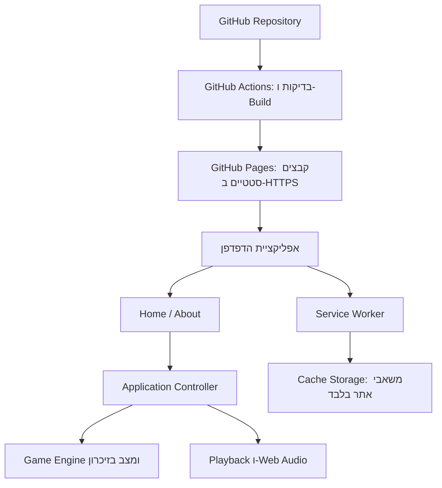

# ARCHITECTURE — משחק Simon

מסמך זה מתרגם את PRD.md לתכנון טכני למימוש. המחקר והתיעוד נבדקו ב-18.10.2026. המערכת היא Frontend בלבד, עם שני מסכים בעברית, עשרה שלבים, PWA ופעולה ללא רשת לאחר הכנת משאבי האתר. אין Backend, Database או שמירה מתמשכת של מצב המשחק.

## 1. Technology Stack שנבחר

| רכיב | בחירה | תפקיד |
|---|---|---|
| שפת פיתוח | TypeScript במצב `strict` | טיפוסים למצב המשחק, אירועים וממשקי Modules |
| ממשק | HTML סמנטי ו-DOM APIs, ללא UI Framework | הצגת שני המסכים וטיפול בפעולות המשתמש |
| עיצוב | CSS רגיל, CSS Grid ו-CSS Custom Properties | לוח ארבעה צבעים, Mobile-first ו-RTL |
| Development ו-Build | Vite, עם תבנית `vanilla-ts` | שרת פיתוח ויצירת אתר סטטי בתיקיית `dist` |
| סביבת כלי הפיתוח | Node.js 24 LTS ו-npm | הרצת Build ובדיקות בלבד; אינם נדרשים במכשיר המשתמש |
| Offline ו-PWA | `vite-plugin-pwa`, עם Workbox במצב `generateSW` | יצירת Manifest ו-Service Worker עם Precache |
| צליל | Web Audio API | יצירת ארבעה צלילים מקומית, ללא קובצי אודיו חיצוניים |
| מצב המשחק | אובייקט TypeScript יחיד בזיכרון | מקור האמת למצב, שלב, רצף וניקוד |
| בדיקות לוגיקה | Vitest | בדיקת כללי המשחק, תזמונים וביטול פעולות |
| בדיקות דפדפן | Playwright (Chromium במצב מובייל) | בדיקת הזרימות המרכזיות ו-Offline על Build אמיתי |
| קוד מקור | Git ו-GitHub | Repository אחד לקוד, הגדרות ו-lockfile |
| CI/CD ו-Hosting | GitHub Actions ו-GitHub Pages | בדיקות, Build ופריסה אוטומטית כאתר סטטי ב-HTTPS |

### החלטות מרכזיות והנמקות

**ממשק ושפה:** נבחנו TypeScript עם DOM APIs, React ו-Vue. שני Frameworks אלה תומכים היטב בממשקים אינטראקטיביים, אך שני מסכים ולוח קטן אינם מצדיקים כאן Runtime ושכבת State נוספת. נבחר TypeScript ללא UI Framework, עם State Machine מפורש. `strict` מסייע למנוע מצבים לא תקינים ומגדיר חוזים ברורים גם לפיתוח באמצעות AI. זו מסקנה הנדסית לפי היקף המוצר, ולא טענה לביצועים שנמדדו. [TypeScript strict](https://www.typescriptlang.org/tsconfig/strict), [React: Interactivity](https://react.dev/learn/adding-interactivity), [Vue: Introduction](https://vuejs.org/guide/introduction).

**כלי Build:** נבחנו Vite, webpack וטעינת JavaScript ללא Bundler. נבחר Vite בזכות תבנית TypeScript מוכנה וחיבור ישיר לתהליך PWA ופריסה סטטית. TypeScript נבדק בנפרד באמצעות `tsc --noEmit`, מפני שהמרת TypeScript ב-Vite אינה מבצעת Type Checking. CSS רגיל מספיק לארבעה כפתורים ושני מסכים; אין צורך בספריית UI. [Vite: Features](https://vite.dev/guide/features), [webpack: TypeScript](https://webpack.js.org/guides/typescript/).

**PWA:** נבחנו Service Worker ידני, Workbox `generateSW` ו-`injectManifest`. נבחר `generateSW` באמצעות התוסף ל-Vite: כל התוכן סטטי, ואין צורך בלוגיקת רשת מותאמת בתוך Worker. רשימת Precache נוצרת מה-Build ומפחיתה סיכון לשכחת משאב חיוני. [Workbox: מצבי יצירה](https://developer.chrome.com/docs/workbox/modules/workbox-build), [Vite PWA: Precache](https://vite-pwa-org.netlify.app/guide/service-worker-precache).

**אודיו:** נבחנו Web Audio API, רכיבי HTML Audio ו-Howler.js. נבחר Web Audio API משום שנדרשים ארבעה צלילים סינתטיים קצרים, עם שליטה במשך הצליל ועצירה מיידית. אין צורך בהורדת קבצים או בתלות נוספת לניהול מדיה. [Web Audio: Best practices](https://developer.mozilla.org/en-US/docs/Web/API/Web_Audio_API/Best_practices), [HTML Audio](https://developer.mozilla.org/en-US/docs/Web/HTML/Reference/Elements/audio), [Howler.js](https://howlerjs.com/).

**בדיקות:** נבחנו Vitest מול Jest, ו-Playwright מול Cypress. נבחר Vitest לשיתוף סביבת Vite ול-Fake Timers, ו-Playwright לאוטומציה של מגע, Viewport וזרימות. בהתאם להיקף המוצר, בדיקות Playwright רצות ב-Chromium בלבד באמולציית מובייל ומכסות את הזרימות המרכזיות; התאמה ל-Safari נבדקת ידנית ב-iPhone אמיתי. כלי הבדיקה הם Development Dependencies בלבד. [Vitest Timers](https://vitest.dev/guide/mocking/timers), [Jest Timer Mocks](https://jestjs.io/docs/timer-mocks), [Playwright Emulation](https://playwright.dev/docs/emulation), [Cypress Cross Browser](https://docs.cypress.io/app/guides/cross-browser-testing).

**Hosting:** נבחנו GitHub Pages ו-Vercel. נבחר GitHub Pages בהתאם להעדפת הפריסה ולתוצר סטטי לחלוטין. אין צורך בשירות Runtime בתשלום, בחשבון Cloud נוסף או ב-Serverless Functions. Vite מתעד את הפריסה באמצעות GitHub Actions ואת התאמת נתיב הבסיס ל-Project Site. [Vite: Static Deploy](https://vite.dev/guide/static-deploy.html), [Vercel: Git integration](https://vercel.com/docs/git).

### עלויות, תאימות ומגבלות

- הנחת תפעול לצורך מסלול ללא עלות: Repository ציבורי ב-GitHub Free, שימוש בכתובת `github.io` ו-Standard Linux Runner. אין במסמך פעולה המפרסמת קוד בפועל. אם יידרש Repository פרטי, GitHub Pages דורש תוכנית מתאימה; אין צורך לשנות את מבנה האפליקציה. [GitHub Pages: זמינות](https://docs.github.com/en/pages/getting-started-with-github-pages/what-is-github-pages).
- Standard GitHub-hosted Runners ב-Repositories ציבוריים זמינים ללא חיוב; תנאי התוכניות עשויים להשתנות. אין שירותי API או אודיו בתשלום. [GitHub Actions Billing](https://docs.github.com/en/billing/concepts/product-billing/github-actions).
- מגבלות Pages כוללות אתר עד 1 GB, מגבלת תעבורה רכה של 100 GB בחודש ו-Deployment Timeout של 10 דקות. מגבלת עשרה Builds לשעה אינה חלה על Custom Actions Workflow. אלה מתאימים למשחק קטן; אם התעבורה תחרוג מהמכסה, ניתן להעביר את אותו תוצר סטטי ל-Hosting אחר. Pages אינו מיועד להפעלת SaaS מסחרי; ב-PRD לא הוגדר מודל כזה. [GitHub Pages Limits](https://docs.github.com/en/pages/getting-started-with-github-pages/github-pages-limits).
- Node.js 24 הוא קו LTS שנבחר לכלי הפיתוח. את גרסאות Vite, TypeScript, התוסף, Workbox וכלי הבדיקות יש לקבע בגרסאות Stable תואמות וב-`package-lock.json`; אין להשתמש ב-`latest` ב-CI או בגרסאות Preview. בעת הקמת הפרויקט יש לוודא `engines` ו-`peerDependencies` ולהריץ Build ובדיקות יחד. המסמך אינו מציג מספרי Patch שלא אומתו בהתקנה. [Node.js Releases](https://nodejs.org/en/about/previous-releases), [Vite: דרישות סביבה](https://vite.dev/guide/).
- התקנה ו-Offline תלויים בתמיכת הדפדפן ובמדיניות האחסון שלו. Cache עלול להימחק על ידי המשתמש או הדפדפן; אין הבטחת Offline לאחר מחיקתו. [MDN: Storage quotas and eviction](https://developer.mozilla.org/en-US/docs/Web/API/Storage_API/Storage_quotas_and_eviction_criteria).

## 2. ארכיטקטורת המערכת

### 2.1 מבנה כללי

Node.js פועל בפיתוח וב-CI בלבד. לוגיקת המשחק, הגרלת הרצפים, הבדיקה והניקוד מתבצעות בדפדפן ללא בקשות שרת. ה-Service Worker אחראי להגשת משאבים בלבד ואינו מנהל משחקים.

### 2.2 Modules ואחריות

| Module | אחריות וקשרים |
|---|---|
| Game Engine | חוקים ומעברי מצב טהורים; מקבל אירועים ומחזיר מצב חדש, ללא DOM, אודיו או רשת |
| Application Controller | מחזיק State יחיד; מעביר אירועים ל-Engine ומפעיל תופעות לוואי בהתאם לתוצאה |
| Views | Home ו-About; קוראות State ומציגות אותו, ושולחות פעולות ל-Controller |
| Sequence Generator | מגריל צבע אקראי מתוך ארבעה צבעים, אחד בתחילת משחק ואחד בכל מעבר שלב; מקבל מקור Random חלופי בבדיקות |
| Playback Controller | מציג רצף, שולט בנעילת הקלט ומבטל תזמונים בעת מעבר מסך או סיום |
| Audio Adapter | מנהל `AudioContext` יחיד, יוצר צלילים ועוצר אותם לפי בקשת Playback |
| Navigation | מעבר מקומי בין שני המסכים באמצעות Hash וניתוב אירועי חזרה |
| PWA Registration | רישום Worker בתוך Scope של האתר ומעקב אחר הצלחת ההכנה ל-Offline |

אין ספריית Global State, ספריית Routing או Event Bus. Views אינן מעדכנות ניקוד או מייצרות רצפים בעצמן. רישום Event Listeners נעשה פעם אחת, והם מנוקים אם רכיב מפורק.

### 2.3 מבנה Frontend וניווט

- מסמך HTML יחיד עם `lang="he"`, `dir="rtl"` ו-Viewport מתאים לנייד.
- שני מצבי תצוגה: `#/` לבית ו-`#/about` לאודות. Hash Routing אינו דורש Rewrite של נתיבים ב-GitHub Pages, ופועל גם ב-Offline.
- בהפעלה חדשה או רענון יש לאתחל State ולהחזיר לבית, גם אם הכתובת מכילה את Hash של אודות. מעבר מקומי בין המסכים אינו טוען מחדש את האפליקציה.
- Home מכיל לוח ארבעה צבעים ואת המצבים ההתחלתי, הפעיל והסופי. About מציג את הניקוד הנוכחי, אזור ״חוקי המשחק״ ואת פעולת החזרה. חוקי המשחק הם תוכן סטטי בעברית, הכלול ב-Bundle וזמין גם ב-Offline. התוכן יכסה שחזור רצף אורות וצלילים, הוספת צבע אחד לסוף הרצף בכל שלב, 10 שלבים, נקודה לכל שלב שהושלם, סיום בטעות הראשונה, ניצחון לאחר 10 שלבים וללא מגבלת זמן לתשובה. אם התוכן חורג מה-Viewport תתאפשר גלילה אנכית בתוך המסך, ללא מסך נוסף.
- כפתורי HTML אמיתיים עם תוויות בעברית; הפרדה חזותית בין הארה, כפתור רגיל וקלט חסום. נעילת קלט נאכפת גם ב-Controller, ולא רק בעיצוב.
- CSS Grid ללוח 2×2, יחידות יחסיות, Logical Properties והתחשבות ב-Safe Areas במצב Standalone. אין עבודה ייעודית על Layout לטאבלט או Desktop.
- התצוגה מתעדכנת בנקודות שינוי State; אין Game Loop מתמשך או Canvas.

### 2.4 Data Model ואחסון

| נתון | טיפוס/ערכים | כללים |
|---|---|---|
| `screen` | `home / about` | מצב ניווט, נפרד משלב המשחק |
| `phase` | `idle / presenting / accepting / paused / won / lost` | מצב חוקי יחיד בכל רגע |
| `stage` | מספר 1–10 | מתחיל ב-1; מתקדם רק אחרי השלמה מלאה |
| `score` | מספר 0–10 | מספר השלבים שהושלמו |
| `sequence` | מערך `blue / red / yellow / green` | אורכו כמספר השלב במשחק פעיל |
| `inputIndex` | מספר 0 עד אורך הרצף | מיקום התשובה הבאה; אין צורך לשמור היסטוריית לחיצות |
| `playbackRunId` | מזהה ריצה עולה | פוסל Callbacks מריצה שבוטלה |

כל הנתונים נשמרים בזיכרון JavaScript בלבד. `AudioContext`, טיימרים ומזהי צלילים הם משאבי Runtime מחוץ למצב העסקי. אין שימוש ב-`localStorage`, ב-`sessionStorage` או ב-IndexedDB לשמירת המשחק. כל לשונית היא משחק עצמאי, ללא סנכרון.

ב-`idle`: ניקוד 0 ורצף ריק. במשחק פעיל ובכישלון: `score = stage - 1`. בניצחון: `stage = 10` ו-`score = 10`. בסיום נשמר הניקוד בזיכרון לצפייה באודות, עד ״משחק חדש״ או רענון. Cache Storage מכיל HTML, JavaScript, CSS, Manifest, אייקונים ומשאבי Workbox בלבד.

### 2.5 State Machine וכללי משחק

| מצב ואירוע | תוצאה |
|---|---|
| `idle` + ״התחל״ | הכנת אודיו, ניקוד 0, יצירת רצף באורך 1 ומעבר ל-`presenting` |
| `presenting` + סיום ההצגה | איפוס `inputIndex` ומעבר ל-`accepting` |
| `accepting` + צבע נכון שאינו האחרון | קידום `inputIndex` ומשוב אור וצליל |
| `accepting` + השלמת רצף, שלב קטן מ-10 | הוספת נקודה, קידום שלב, הוספת צבע אקראי אחד לסוף הרצף הקיים ומעבר ל-`presenting` |
| `accepting` + השלמת שלב 10 | ניקוד 10, ביטול Playback ומעבר ל-`won` |
| `accepting` + צבע שגוי | מעבר מיידי ל-`lost`, ללא תוספת ניקוד |
| משחק פעיל + מעבר לאודות | ביטול Playback, איפוס תשובה חלקית ומעבר ל-`paused` |
| משחק פעיל + הדף מוסתר (נעילה/רקע) | ביטול Playback, איפוס תשובה חלקית ומעבר ל-`paused`; המסך נשאר הבית |
| `paused` + חזרה לבית מאודות, או ״המשך״ בבית | הצגת אותו רצף מחדש מבלי להגריל או לשנות ניקוד |
| `won / lost` + ״משחק חדש״ | ביטול משאבים, איפוס מלא והתחלת שלב 1 עם צבע אקראי חדש |

ההגרלה היא `Math.floor(Math.random() * 4)` לכל צבע שנוסף; אין צורך באקראיות קריפטוגרפית. מותרות חזרות, ואף רצף זהה בין משחקים במקרה. אין להתערב בתוצאה כדי לכפות גיוון. אירוע צבע בכל מצב שאינו `accepting` נדחה ללא השפעה. הפעולה העסקית מתבצעת סינכרונית לפני המתנה למשוב, כדי למנוע ניקוד כפול בלחיצות מהירות.

### 2.6 תזמון, צליל וביטול

- לכל פריט ברצף: הארה וצליל במשך 500 מילישניות. בין פריטים בלבד יש הפסקה של 250 מילישניות. לאחר כיבוי הפריט האחרון נפתח הקלט. אין Timeout לתשובה.
- ארבעה תדרים קבועים שונים יוגדרו במפת צבעים אחת, המשמשת גם את הצגת הרצף וגם את משוב הלחיצה. התדרים עצמם הם פרט מימוש, ללא משמעות עסקית.
- יצירת או חידוש `AudioContext` מתבצעים בתוך מחוות משתמש: ״התחל״, ״משחק חדש״, ״המשך״ או חזרה מאודות. אין להסתמך על Autoplay בעת טעינת האתר. [MDN: Autoplay](https://developer.mozilla.org/en-US/docs/Web/Media/Guides/Autoplay).
- Playback מפעיל כל פריט לפי שעון מונוטוני ומבצע סנכרון חזותי לצליל. אין להתחיל מראש רצף שלם של צלילים שלא ניתן לבטל. סטיות קלות עקב תזמון הדפדפן אפשריות; אין הבטחת דיוק של מערכת Real-time.
- בעת השהיה, סיום או התחלה חדשה: לבטל טיימרים, לעצור Oscillators פעילים, לכבות הארות ולהגדיל `playbackRunId`. כל Callback בודק שמזהה הריצה והמצב עדיין תואמים לפני עדכון.
- משוב הלחיצה אינו חוסם לחיצות תקינות מהירות; המשוב הקודם נקטע לפי הצורך. השלמת שלב מפעילה את הרצף הבא רק לאחר סיום המשוב הקצר, כשהקלט כבר חסום.
- כשל בחידוש אודיו אינו כישלון במשחק: אין להתקדם ברצף שלא נשמע. יש להפסיק Playback ולשמור את המצב. בהפעלה ראשונית ניתן לנסות שוב עם ״התחל״; בחזרה מאודות ניתן לנסות שוב דרך פעולת החזרה. הודעת תקלה תופיע בתוך המסך הקיים בעברית.

### 2.7 Lifecycle במובייל

דפדפנים עשויים להאט טיימרים ולהשהות אודיו כאשר האתר ברקע. יש לבטל Playback עם `visibilitychange` כאשר הדף מוסתר, ולהימנע משחזור Callbacks שהצטברו. [MDN: Page Visibility](https://developer.mozilla.org/en-US/docs/Web/API/Page_Visibility_API).

לפי ה-PRD, הפרעה למשחק פעיל (נעילת המכשיר או מעבר לאפליקציה אחרת) מעבירה אותו למצב `paused` והמסך נשאר הבית. בבית מוצג ״המשך״ במקום ״התחל״; הלחיצה עליו היא מחוות המשתמש שמחדשת את האודיו ומציגה שוב את אותו רצף. אין שינוי ניקוד או ענישה. אם המשתמש נמצא באודות בזמן ההפרעה, המשחק כבר מושהה ואין שינוי. טעינה חדשה מלאה תמיד מאפסת את המשחק. סגירת התהליך על ידי מערכת ההפעלה עלולה לאבד מצב בזיכרון, בהתאם לאיסור על שמירת משחקים.

### 2.8 PWA ופעולה ללא רשת

**Manifest והתקנה:** שם ותיאור בעברית, `lang: he`, `dir: rtl`, תצוגת `standalone`, אייקוני PNG בגודל 192×192 ו-512×512, אייקון Maskable ו-Apple Touch Icon. `id`, `start_url` ו-`scope` יהיו בתוך נתיב האתר. ההתקנה תיעשה באמצעות ממשק הדפדפן או מערכת ההפעלה; אין צורך במסך התקנה נוסף. ב-iOS וב-Android תהליך ההתקנה עשוי להיות שונה. [MDN: Installability](https://developer.mozilla.org/en-US/docs/Web/Progressive_web_apps/Guides/Making_PWAs_installable).

**Precache:** `generateSW` יכלול את ה-HTML, כל Bundles של JavaScript ו-CSS, Manifest, אייקונים ואת Workbox Runtime המקומי. יש להגדיר במפורש את דפוסי הקבצים ולהכליל קובצי Public הדרושים להפעלה. כל המשאבים יוגשו מאותו אתר; אין Google Fonts, CDN בזמן Runtime או קובצי צליל מרוחקים. צלילים נוצרים מקומית וגופן המערכת משמש לממשק.

**נתיב וסביבת אירוח:** ב-Project Site יוגדר `base: '/<repository>/'`. רישום ה-Worker, ה-Scope, קישורי האייקונים וה-Manifest ישתמשו באותו Base; Worker ימוקם בשורש הפרויקט המפורסם. Navigation Fallback יחזיר את `index.html` שבאותו Base בלבד. Hash אינו נשלח לשרת, ולכן שני המסכים חולקים App Shell אחד.

**מוכנות:** הצגת האתר בפעם הראשונה אינה מוכיחה שכל המשאבים כבר נשמרו. Offline זמין רק לאחר הצלחת התקנת ה-Worker וה-Precache. כשל בהתקנת Cache לא יחסום משחק שכבר נטען; האפליקציה לא תסמן אותו כמוכן ל-Offline. טעינה ראשונה ללא רשת או לאחר מחיקת Cache אינה מובטחת. בדיקת מוכנות מתבססת על מחזור החיים של ה-Worker, לא על `navigator.onLine` בלבד. [MDN: PWA Caching](https://developer.mozilla.org/en-US/docs/Web/Progressive_web_apps/Guides/Caching).

**עדכון גרסאות:** גרסה חדשה לא תרענן משחק פעיל. ה-Worker החדש ימתין לפי מחזור החיים הרגיל, והגרסה החדשה תתקבל בפתיחה הבאה של האתר. אין Dialog עדכון. (מימוש: `registerType: 'prompt'` בלי לקרוא לעדכון; זו התנהגות ברירת המחדל של Workbox.) ה-Caches יקבלו Prefix ייחודי לפרויקט. [Vite PWA: Update behavior](https://vite-pwa-org.netlify.app/guide/prompt-for-update).

### 2.9 APIs ו-Data Flow

אין REST API, GraphQL, WebSocket או אינטגרציות חיצוניות. הממשקים הם קריאות TypeScript פנימיות ואירועי דפדפן בלבד. התקשורת ברשת מוגבלת לטעינת קבצים סטטיים ולבדיקת עדכון Service Worker.

זרימת משחק: פעולת משתמש → Navigation או Controller → בדיקת חוקיות ב-Engine → State חדש → עדכון Views והפעלת Playback לפי הצורך. בתום הצגת רצף Playback שולח אירוע השלמה עם מזהה הריצה; לאחר מכן ניתן להזין תשובה. About קורא את אותו `score`, ללא עותק נוסף, ומציג לצדו את חוקי המשחק הסטטיים. ב-Offline ה-Worker מספק את משאבי האפליקציה מה-Cache; כל זרימת המשחק נשארת זהה.

### 2.10 אבטחה ופרטיות

- אין חשבונות, Authentication, Authorization או נתוני משתמש להזדהות. אין סודות או API Keys בדפדפן.
- להפעיל HTTPS ב-GitHub Pages; זה גם תנאי להפעלת PWA בסביבת Production.
- אין Analytics, Cookies יישומיים או שליחת תוצאות. GitHub עצמו מתעד כתובות IP לצורכי אבטחה ברמת ה-Hosting. [GitHub Pages: Data collection](https://docs.github.com/en/pages/getting-started-with-github-pages/what-is-github-pages).
- להשתמש ב-`textContent` לטקסטים ובערכי צבע מוגדרים, ללא הכנסת HTML ממקורות חיצוניים. אין טעינת Scripts בזמן Runtime ממקור צד שלישי.
- ה-Repository כולל lockfile; Workflow משתמש בהרשאות מינימליות וב-Actions הרשמיים של GitHub בגרסה ראשית קבועה (למשל `@v4`). אין Secrets ב-Repository ואין צורך ב-Personal Access Token לפריסת Pages באמצעות ההרשאות המובנות.
- הניקוד ניתן לשינוי דרך Developer Tools; אין מנגנון Anti-cheat, משום שאין שיאים ציבוריים או תוצאות הנשמרות בשרת.

## 3. Development, Build ו-Deployment

קוד המקור, ההגדרות וה-lockfile ינוהלו ב-Repository אחד ב-GitHub. `main` הוא ענף Production והעבודה נדחפת אליו ישירות, ללא Pull Requests. כל Push ל-`main` מפעיל פריסה אוטומטית באמצעות Pages כשה-Source מוגדר GitHub Actions. אין צורך להחזיק שרת פיתוח קבוע בענן או סביבת נתונים נפרדת.

תהליך CI/CD מוגדר כרצף מחייב: `npm ci` → `tsc --noEmit` → `vitest run` → `vite build` → בדיקות Playwright על אותו `dist` → העלאת אותו Artifact באמצעות `upload-pages-artifact` → פרסום באמצעות `deploy-pages`. אין לבצע Build נוסף לאחר הבדיקות. Node.js 24 משמש גם מקומית וגם ב-CI. `vite preview` מתאים לבדיקת התוצר, ואינו שרת Production. [Vite: GitHub Pages deployment](https://vite.dev/guide/static-deploy.html).

לשלב הפרסום נדרשות הרשאות `pages: write`, `id-token: write` וקריאת תוכן, עם Environment בשם `github-pages`. יש לסדר פריסות בקבוצת Concurrency אחת. כשל בדיקות או Build מונע פריסה. חזרה לגרסה קודמת נעשית ב-`git revert` ודחיפה ל-`main`, שמפעילה את אותו תהליך.

התצורה הציבורית כוללת רק Base URL, Manifest וקבועי המשחק: 10 שלבים, 500 מילישניות הארה ו-250 מילישניות הפסקה. אין משתני סביבה סודיים, Database Migrations או פרטי גישה לשירותים חיצוניים.

## 4. אימות הארכיטקטורה מול דרישות המוצר

| תחום | אימות נדרש |
|---|---|
| חוקי המשחק | אורך רצף כמספר השלב; כל שלב שומר את הרצף הקודם ומוסיף צבע אחד; חזרות מותרות; טעות ראשונה מסיימת; אין ניקוד חלקי; ניצחון בדיוק בניקוד 10 |
| קלט ותזמון | קלט חסום בהצגה ובסיום; 500/250 מילישניות; אין Timeout; אין ניקוד כפול או Callback ישן לאחר ביטול |
| מעבר מסכים | הצגת חוקי המשחק והניקוד באודות, גם ב-Offline; השהיה מאמצע הצגה ומאמצע תשובה; שמירת השלב והניקוד; הצגת אותו רצף ואיפוס התשובה החלקית בחזרה |
| איפוס | רענון, גם ב-Offline ובכתובת אודות, חוזר לבית עם ניקוד 0; ״משחק חדש״ מתחיל שלב 1 |
| Offline אמיתי | Build מוגש ב-Base של Project Site; ממתינים ל-Worker ול-Precache, עוברים ל-Offline וטוענים מחדש; בודקים משחק ושני מסכים ללא תלות ברשת |
| הפרעה במובייל | הסתרת הדף בזמן משחק עוצרת את ה-Playback; בחזרה מוצג ״המשך״, ולחיצה עליו מציגה שוב את אותו רצף |
| מובייל וצליל | בדיקות Chromium באמולציית מובייל; בדיקה ידנית על מכשירי Android ו-iPhone אמיתיים להתקנה, אודיו, נעילה וחזרה מרקע |

בבדיקות Offline יש להשאיר Service Workers פעילים ולהשתמש ב-Browser Context חדש ומבודד לכל תרחיש. אמולציית Playwright אינה מחליפה בדיקת התקנה או שמע במכשיר אמיתי. בדיקות Unit משתמשות במקור Random נשלט וב-Fake Timers, בלי לשנות את ההגרלה ב-Production. [Playwright: Network ו-Service Workers](https://playwright.dev/docs/network), [Playwright: Emulation](https://playwright.dev/docs/emulation).

הארכיטקטורה אינה מוסיפה מסכים, היסטוריה, Backend, Database, שירותי AI או שמירת התקדמות. כל זרימות המשתמש, כולל הטיפול בהפרעה במובייל, מוגדרות ב-PRD.

## החלטות מרכזיות (ADRs)

### ADR-1: גופן Heebo נארז מקומית דרך `@fontsource/heebo`
**הקשר:** DESIGN.md מגדיר את Heebo כגופן הממשק, אך האתר צריך לעבוד ב-Offline ואסור לטעון גופנים ממקור חיצוני בזמן Runtime.
**החלטה:** הגופן נכלל כתלות npm (`@fontsource/heebo`), רק במשקלים 400 ו-700 ובתתי-הקבוצות hebrew ו-latin. Vite אורז את קובצי הגופן לתוך `dist`.
**השלכות:** אין בקשות ל-Google Fonts. תוספת של כ-35KB (woff2) לאתר. באבן דרך 4 קובצי הגופן ייכללו ב-Precache.

### ADR-2: TypeScript 7
**הקשר:** בעת הקמת הפרויקט (אוקטובר 2026) הגרסה היציבה העדכנית של TypeScript היא 7.x.
**החלטה:** הפרויקט משתמש ב-TypeScript 7.0.2 (מקובע ב-`package.json`) לבדיקת טיפוסים בלבד (`tsc --noEmit`). Vite מבצע את ההמרה.
**השלכות:** אין. אם כלי כלשהו לא יתמוך בגרסה 7, ניתן לחזור ל-5.x בלי לשנות קוד.

### ADR-3: שליטה ב-Random בבדיקות דפדפן דרך `addInitScript`
**הקשר:** בדיקות Playwright צריכות לדעת מראש את הרצף כדי לשחק עד ניצחון או כישלון, בלי לשנות את ההגרלה ב-Production.
**החלטה:** בבדיקות בלבד, `page.addInitScript` מחליף את `Math.random` בפונקציה שמחזירה תמיד 0 (כל הרצפים כחולים). ב-Vitest ה-Engine וה-Controller מקבלים פונקציית Random כפרמטר.
**השלכות:** אין בקוד ה-Production "מצב בדיקה" או משתנה סביבה. אותה טכניקה משמשת לדימוי כשל אודיו (החלפת `AudioContext`) ולתיעוד הצלילים שהושמעו.

### ADR-4: משכי משוב ומעבר שלב, ותדרי הצלילים
**הקשר:** ה-PRD מגדיר 500/250 מילישניות להצגת רצף, אך לא את משך המשוב ללחיצה, את ההפסקה לפני רצף חדש או את התדרים.
**החלטה:** משוב לחיצה (אור + צליל) של 300ms; הרצף הבא מתחיל 800ms אחרי הלחיצה שהשלימה שלב (300ms משוב + 500ms הפסקה). צליל אחד בכל רגע (צליל חדש קוטע קודם). תדרים בגל `triangle`: ירוק 415Hz, אדום 310Hz, צהוב 252Hz, כחול 209Hz (גובהי ה-Simon הקלאסי). הקבועים ב-`src/config.ts`.
**השלכות:** ניתן לכוונן את הערכים במקום אחד. ההצגה מתוזמנת פריט-אחר-פריט ב-`setTimeout`, ולכן ביטול הוא מיידי.

### ADR-5: חזרה מאודות ו״המשך״ עוברות באותו מסלול, עם נפילה ל״המשך״ בכשל אודיו
**הקשר:** חזרה לבית יכולה להגיע מכפתור ״חזרה למשחק״ או מכפתור Back של הדפדפן. Back אינו בהכרח מחוות משתמש שמאפשרת לחדש אודיו.
**החלטה:** כל שינוי מסך עובר דרך אירוע `hashchange` יחיד (לפי `event.newURL`, כדי ששינויים מהירים ייקלטו בסדר הנכון). בחזרה לבית במצב `paused` מנסים לחדש את האודיו ולהציג את הרצף. אם החידוש נכשל, המשחק נשאר `paused` בבית, עם הודעת התקלה הקיימת וכפתור ״המשך״ לניסיון חוזר — אותו כפתור שמוצג אחרי נעילת מכשיר או מעבר לאפליקציה אחרת.
**השלכות:** אין רצף שמוצג בלי צליל ואין מסך נוסף. ״חזרה למשחק״ מוסיף רשומה להיסטוריה של הדפדפן (פשטות על פני ניהול היסטוריה).

### ADR-6: דימוי הסתרת הדף בבדיקות הדפדפן
**הקשר:** Playwright אינו יכול להעביר דף לרקע או לנעול מכשיר באמת.
**החלטה:** הבדיקה מגדירה את `document.hidden` ו-`visibilityState` ושולחת אירוע `visibilitychange`. בדיקה אמיתית של נעילה וחזרה מרקע נעשית במכשירים באבן דרך 5.
**השלכות:** הלוגיקה נבדקת אוטומטית; ההתנהגות בפועל של דפדפני מובייל (השהיית אודיו וטיימרים) מאומתת רק ידנית.

### ADR-7: אייקון האפליקציה
**הקשר:** הארכיטקטורה מגדירה את גדלי האייקונים (192, 512, Maskable, Apple Touch), אך לא את המראה שלהם.
**החלטה:** ריבוע Charcoal (`#181A1B`) ועליו ארבעה ריבועים מעוגלים בצבעי המשחק, באותם מיקומים כמו בלוח (כחול ימין למעלה, אדום שמאל למעלה, צהוב ימין למטה, ירוק שמאל למטה), ללא טקסט. המקור הוא `public/icon.svg`; קובצי ה-PNG נוצרים ב-`npm run icons` (`@vite-pwa/assets-generator`, הגדרות ב-`pwa-assets.config.ts`) ונשמרים ב-Git.
**השלכות:** ה-Build הרגיל אינו יוצר אייקונים. שינוי באייקון = עריכת ה-SVG והרצת `npm run icons`.

### ADR-8: מעקב מוכנות ל-Offline ותוכן ה-Precache
**הקשר:** צריך לדעת מתי האתר באמת מוכן לעבוד בלי רשת, בלי להוסיף ממשק שה-PRD וה-DESIGN אינם מגדירים.
**החלטה:** הרישום נמצא ב-`src/app/pwa.ts` (`registerType: 'prompt'`, בלי טיפול ב-`onNeedRefresh`). הדף מסומן כמוכן (`data-offline-ready="true"` על `<html>`, לא נראה למשתמש) רק כש-Worker הותקן עם ה-Precache המלא: מ-`onOfflineReady` בביקור הראשון, או כשכבר קיים Worker פעיל מביקור קודם. ה-Precache כולל HTML, JS, CSS, גופני `woff2` בלבד (דפדפנים מודרניים אינם טוענים `woff`), אייקונים ו-Manifest. `skipWaiting` ו-`clientsClaim` נשארים כבויים, ולכן הדף הראשון אינו נשלט על ידי ה-Worker עד הטעינה הבאה.
**השלכות:** אין חיווי Offline במסך. בדיקות הדפדפן ממתינות לסימון ולטעינה מחדש לפני ניתוק הרשת. ה-Worker כבוי ב-`npm run dev` ופועל רק ב-Build / Preview.
