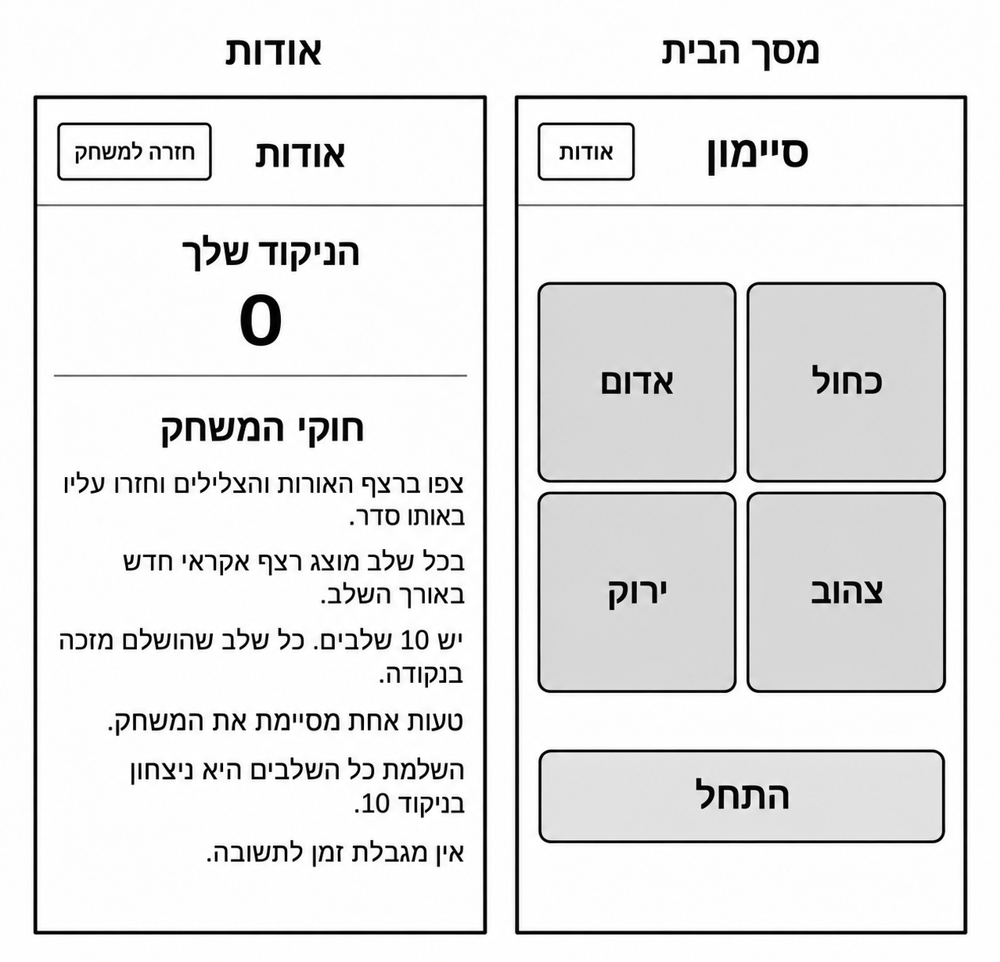
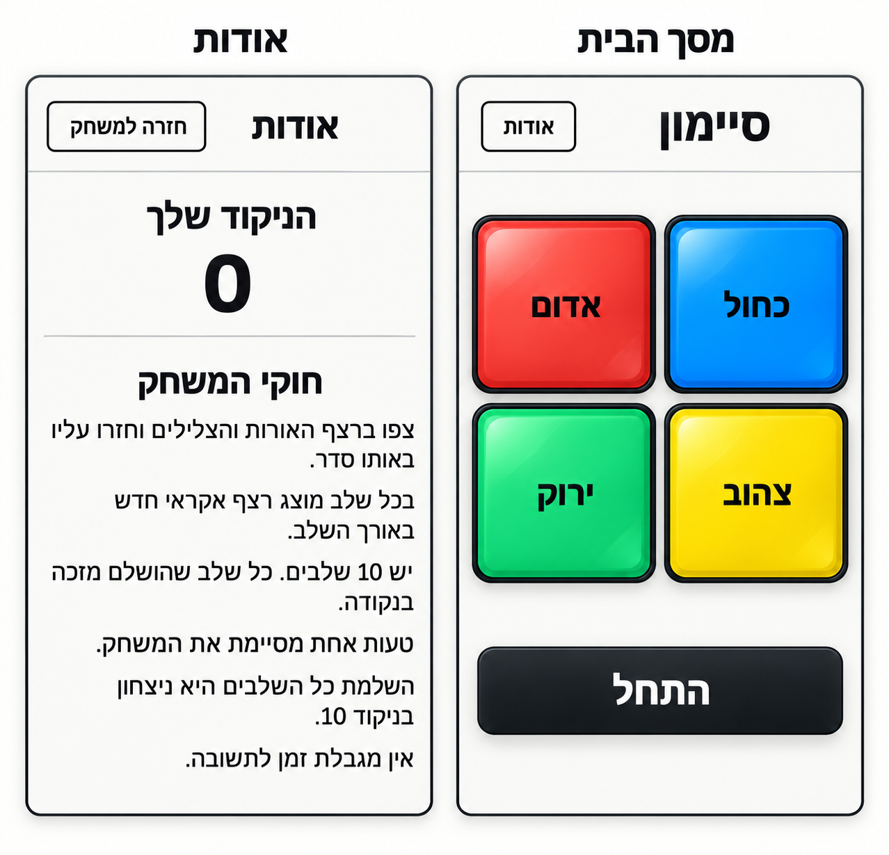
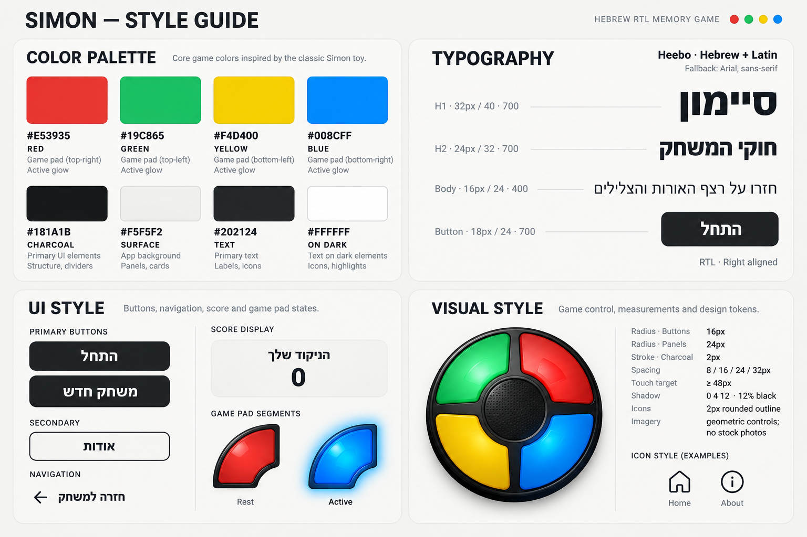

# DESIGN — משחק Simon

מסמך העיצוב מבוסס על [PRD.md](PRD.md), ה-Wireframes, ה-Style Guide וה-Mockups. ה-PRD מגדיר התנהגות; ה-Wireframes מגדירים מבנה ותוכן; ה-Style Guide מגדיר שפה חזותית; ה-Mockups מגדירים את מראה המסכים הסופי.

כאשר יש הבדל בין המקורות, מבנה המסך והתוכן נשמרים לפי ה-Wireframes. בפרט, לוח המשחק הוא Grid של ארבעה כפתורים מרובעים עם פינות מעוגלות, כפי שמופיע גם ב-Mockups. הלוח העגול שב-Style Guide הוא השראה לגימור ולחומריות בלבד. גם מיקום הצבעים נקבע לפי ה-Wireframes וה-Mockups.

## 1. Screens — מסכי האפליקציה

### מבנה המסכים

### 1.1 מסך הבית

**מטרת המסך:** התחלת המשחק, אינטראקציה עם כפתורי הצבע וצפייה בתוצאה בסיום.

**מבנה ותוכן:**

- Header עם הכותרת ״סיימון״ בצד ימין וכפתור Secondary מסוג Outline עם התווית ״אודות״ בצד שמאל. קו הפרדה דק מתחת ל-Header.
- מתחת ל-Header מופיע לוח מרכזי ב-Grid של שתי עמודות ושתי שורות. הכפתורים שווים בגודלם, כמעט מרובעים, ומופרדים ברווח אחיד.
- סידור הכפתורים קבוע במרחב, גם ב-RTL:

| שורה | צד ימין | צד שמאל |
|---|---|---|
| עליונה | ״כחול״ | ״אדום״ |
| תחתונה | ״צהוב״ | ״ירוק״ |

- שם הצבע ממורכז בתוך כל כפתור, בטקסט כהה ומודגש.
- מתחת ללוח מופיע כפתור Primary רחב עם התווית ״התחל״. רוחבו תואם בקירוב לרוחב הלוח, עם הפרדה אנכית ברורה ביניהם.
- נשמר שטח פנוי מתחת לכפתור, בהתאם ל-Mockup. במצב ההתחלתי לא מוצגים במסך זה ניקוד, מונה שלבים או פקדים נוספים.
- **מונה התקדמות:** במהלך משחק מוצגת שורה ממורכזת אחת בין ה-Header ללוח, בנוסח ״שלב 3 · ניקוד 2״, בסגנון Body מודגש בצבע Text. השורה אינה מוצגת במצב ההתחלתי. מקומה נשמר גם כשהיא ריקה, כדי שהלוח לא יקפוץ.

**פעולות וניווט:** ״התחל״ מפעיל את המשחק; ארבעת כפתורי הצבע משמשים להזנת התשובה; ״אודות״ מעביר למסך אודות. התנהגות ההשהיה והחזרה מוגדרת ב-PRD.

**מצבים חזותיים:** כפתור צבע פעיל מקבל הארה ו-Glow בהתאם לדוגמת Active שב-Style Guide, תוך שמירת הצבע, הצורה והתווית. **קלט חסום:** בזמן הצגת הרצף ובסיום משחק, כפתורי הצבע שאינם מוארים מעומעמים (שקיפות של כ-60%), והכפתור המואר מוצג במלוא הבהירות וה-Glow. בזמן הזנת התשובה כל הכפתורים בבהירות מלאה. במהלך משחק כפתור ״התחל״ אינו מוצג; מקומו נשאר ריק.

**מצבי סיום:** מוצגים בתוך מסך הבית, **במקום כפתור ״התחל״**, מתחת ללוח. מלמעלה למטה: הכותרת ״ניצחון!״ או ״המשחק נגמר״ בסגנון H2, השורה ״הניקוד שלך: 7״ בסגנון Body, וכפתור Primary רחב ״משחק חדש״. הלוח נשאר במקומו. אין מסך חדש או Modal.

**המשך אחרי הפרעה:** אם המשחק נעצר בגלל נעילת המכשיר או מעבר לאפליקציה אחרת, מוצג במקום ״התחל״ כפתור Primary רחב ״המשך״, באותו סגנון.

### 1.2 אודות

**מטרת המסך:** הצגת ניקוד המשחק וחוקי המשחק, עם אפשרות לחזור לבית.

**מבנה ותוכן:**

- Header באותו מבנה של הבית: ״אודות״ בצד ימין וכפתור Outline עם התווית ״חזרה למשחק״ בצד שמאל. קו הפרדה דק מתחתיו.
- אזור ניקוד ממורכז בראש התוכן: התווית ״הניקוד שלך״ ומתחתיה מספר גדול ומודגש. הערך 0 שבתמונות הוא דוגמה; במימוש מוצג הערך הנוכחי.
- קו הפרדה אופקי בין אזור הניקוד לחוקים. לפי ה-Mockup, הניקוד אינו עטוף בכרטיס נפרד.
- הכותרת ״חוקי המשחק״ ממורכזת מתחת לקו ההפרדה.
- החוקים מוצגים כפסקאות נפרדות מיושרות לימין, ללא מספור, אייקונים או תבליטים, בנוסח הבא. הנוסח כאן מחייב: בתמונות מופיע בפסקה השנייה נוסח ישן (״בכל שלב מוצג רצף אקראי חדש באורך השלב״) שאינו תואם את המשחק, ויש להתעלם ממנו. כמו בסיימון המקורי, בכל שלב הרצף הקודם נשמר ונוסף צבע אחד לסופו:

> צפו ברצף האורות והצלילים וחזרו עליו באותו סדר.
>
> בכל שלב נוסף צבע אחד לסוף הרצף.
>
> יש 10 שלבים. כל שלב שהושלם מזכה בנקודה.
>
> טעות אחת מסיימת את המשחק.
>
> השלמת כל השלבים היא ניצחון בניקוד 10.
>
> אין מגבלת זמן לתשובה.

**פעולות וניווט:** ״חזרה למשחק״ מחזיר לבית. אין במסך עריכת ניקוד, היסטוריית תוצאות או פעולות נוספות. יש לשמור על קריאות הטקסט; במכשיר שבו התוכן ארוך מה-Viewport תתאפשר גלילה אנכית, ללא כיווץ הגופן כדי להכניס הכול למסך אחד.

### מראה סופי וניווט כללי

שני המסכים חולקים Header, שוליים ושפה חזותית. הניווט מתבצע באמצעות ״אודות״ בבית ו״חזרה למשחק״ באודות. אין Bottom Navigation, תפריט צד או מסך נוסף. בלוח התמונות הבית נמצא מימין ואודות משמאל; כותרות המסכים שמעל המסגרות הן חלק מהצגת התוצר ואינן רכיב נוסף בממשק עצמו. גם מסגרת המסך והצל החיצוני בתמונות אינם מסגרת פנימית שיש להוסיף לאתר.

## 2. Style Guide — השפה העיצובית

### 2.1 Color Palette

| Token | HEX | שימוש |
|---|---|---|
| Red | `#E53935` | כפתור ״אדום״, שמאל למעלה |
| Green | `#19C865` | כפתור ״ירוק״, שמאל למטה |
| Yellow | `#F4D400` | כפתור ״צהוב״, ימין למטה |
| Blue | `#008CFF` | כפתור ״כחול״, ימין למעלה |
| Charcoal | `#181A1B` | כפתורי Primary ומעטפת כהה סביב כפתורי הצבע |
| Surface | `#F5F5F2` | רקע המסכים והמשטחים הבהירים |
| Text | `#202124` | כותרות, טקסט, ספרות ותוויות על רקע בהיר או צבעוני |
| On Dark | `#FFFFFF` | טקסט על כפתורי Primary כהים והברקות עדינות |

צבעי ה-HEX הם צבעי הבסיס. ב-Mockups מופיעים מעליהם Gradients והברקות ליצירת עומק. ערכי Gradient Stops וגוני קווי ההפרדה לא הוגדרו במדויק; יש להתאים אותם חזותית לתמונה בלי להתייחס אליהם כ-Tokens מתועדים. צבעי המשחק מרוכזים בלוח; יתר הממשק נשאר ניטרלי.

### 2.2 Typography

המשפחה המוגדרת ב-Style Guide היא **Heebo**, התומכת בעברית וב-Latin. ה-Fallback הוא `Arial, sans-serif`.

| תפקיד | Font Size | Line Height | Font Weight | דוגמה |
|---|---|---|---|---|
| H1 | 32px | 40px | 700 | ״סיימון״, כותרת המסך ״אודות״ |
| H2 | 24px | 32px | 700 | ״חוקי המשחק״ |
| Body | 16px | 24px | 400 | פסקאות החוקים |
| Button | 18px | 24px | 700 | ״התחל״, ״אודות״, ״חזרה למשחק״ |

המספר באזור הניקוד גדול ומודגש יותר מטקסט הגוף, כפי שמופיע ב-Mockup. לא הוגדרו עבורו גודל מדויק או Line Height נפרד. גם תוויות הצבעים מודגשות וממורכזות; אין להעתיק מידות פיקסלים מהתמונה עצמה, שמציגה מסכים בקנה מידה מוגדל.

בחירת Heebo היא בחירה עיצובית, ולא הוראה לטעון Google Fonts בזמן Runtime. בהתאם לאילוץ Offline ולהחלטות הארכיטקטורה, אין להוסיף תלות ברשת עבור גופנים. אם משלבים את Heebo, הוא צריך להיכלל במשאבי האתר המקומיים; אחרת יש להשתמש ב-Fallback המוגדר. המסמך אינו משנה את דרישות הטעינה או את הארכיטקטורה.

### 2.3 UI Style

**Primary Buttons:** משטח Charcoal, טקסט לבן מודגש וממורכז, פינות מעוגלות והברקה עדינה. כפתור ״התחל״ רחב; ״משחק חדש״ משתמש באותה שפה חזותית. הגימור נותן תחושת כפתור פיזי בלי להוסיף אלמנטים סביבו.

**Secondary Buttons וניווט:** רקע בהיר, קו מתאר כהה וטקסט כהה מודגש. כפתורי ה-Header נשארים בגודל שמתאים לתוכן ובמיקום המופיע ב-Mockup. דוגמת קישור הטקסט והאייקונים ב-Style Guide אינה מחליפה את כפתורי ה-Outline המופיעים במסכים הסופיים; אין להוסיף אייקונים שלא מוצגים בהם.

**Game Pads:** ארבעה ריבועים בעלי פינות מעוגלות, מעטפת כהה, שוליים פנימיים מודגשים, צבע רווי והברקה רכה. לכל כפתור תווית כהה במרכז. מצב Rest שומר על הגימור הבסיסי; מצב Active מוסיף הארה ו-Glow בגוון הכפתור. אין להוסיף חלקים של לוח עגול, מרכז דקורטיבי או סימן מסחרי.

**ניקוד ותוכן:** הניקוד מוצג ישירות על רקע המסך, ללא Card נוסף. החוקים הם תוכן טקסטואלי פשוט, עם הפרדה באמצעות Spacing וקו אופקי. אין במוצר שדות קלט, טפסים, רשימות בחירה או תפריטים הדורשים סגנון נוסף.

### 2.4 Visual Style

האווירה משלבת משחק אלקטרוני קלאסי עם ממשק בהיר ופשוט: צבעים בוהקים וגימור מעט מבריק באזור המשחק, לצד טקסט כהה ושטחים שקטים בשאר המסך. ההשראה לצעצוע מתבטאת בחומריות הכפתורים, ולא בהצגת תמונה של צעצוע.

| מאפיין | ערך המוגדר ב-Style Guide | יישום |
|---|---|---|
| Button Radius | 16px | פינות כפתורים |
| Panel Radius | 24px | בסיס לסגנון משטחים מעוגלים, כאשר הם קיימים; אינו מחייב הוספת Panels |
| Stroke | 2px, Charcoal | בסיס לקווי מתאר; כפתורי המשחק כוללים גם מעטפת שכבתית לפי ה-Mockup |
| Spacing Scale | 8 / 16 / 24 / 32px | רווחים פנימיים, הפרדת רכיבים ושולי תוכן |
| Touch Target | לפחות 48px | שטח מגע לכפתורים |
| Shadow | `0 4px 12px`, שחור ב-12% | בסיס לצל רך; אין להחיל צל על כל רכיב |
| Icon Style | קו מעוגל בעובי 2px | שפה לאייקונים שב-Style Guide; אין אייקונים נוספים במסכים הסופיים |

**Layout ויישור:** תכנון Mobile-first עם עמודת תוכן יחידה. בבית, הלוח נשאר Grid של 2×2 עם כפתורים שווים ורווחים אחידים. באודות, סדר התוכן הוא Header, ניקוד, הפרדה וחוקים. הטקסטים אינם נפרסים בעמודות. יש לשמר את יחסי הגודל וההיררכיה שב-Mockups באמצעות ה-Spacings והטיפוגרפיה, ולא על ידי קיבוע המסך למידות התמונה.

**תמונות ואיורים:** אין תמונות תוכן, Stock Photos או איורים דקורטיביים במסכים. לוח המשחק הוא רכיב אינטראקטיבי מעוצב; אין להחליפו בצילום שטוח. אין להוסיף רקעים מצוירים או קישוטים שלא מופיעים ב-Mockups.

### 2.5 שפה וכיווניות

הממשק בעברית וב-RTL. הכותרת ב-Header מיושרת לימין ופעולת הניווט נמצאת משמאל. החוקים מיושרים לימין; תוויות הכפתורים, אזור הניקוד וכותרת ״חוקי המשחק״ ממורכזים לפי ה-Mockups. סדר הצבעים בטבלת מסך הבית הוא מיקום פיזי קבוע ואינו מתהפך אוטומטית בגלל RTL. יש לוודא שסימני פיסוק ומספרים בתוך משפטים בעברית מוצגים בסדר הנכון.
